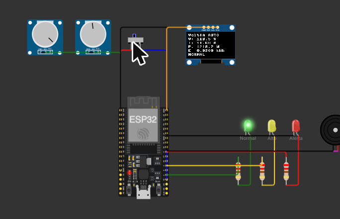
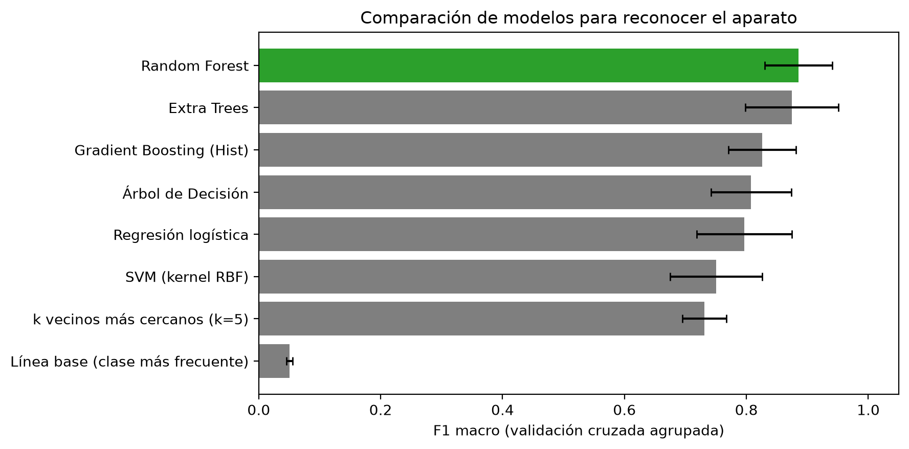
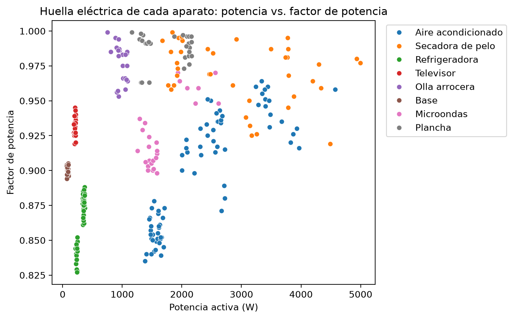
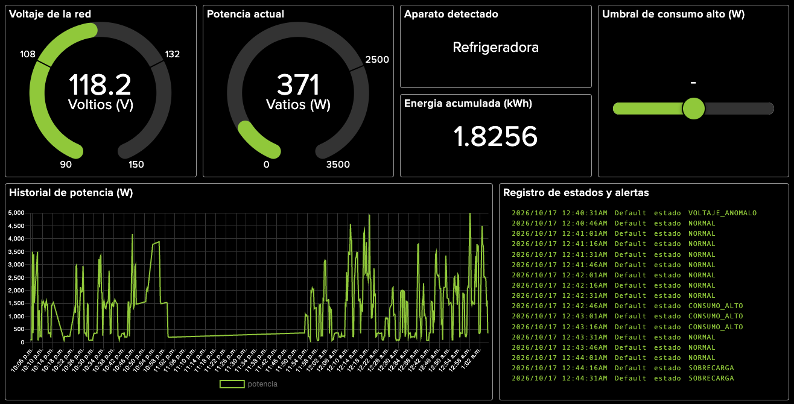

# VoltIA — Monitor inteligente de consumo eléctrico

Sistema **IoT + IA** que mide voltaje, corriente, potencia y energía con un **ESP32**, publica los datos en **Adafruit IO** por MQTT, muestra un dashboard en tiempo real, envía alertas por **Telegram** y usa un modelo **Random Forest** para reconocer **qué aparato** está consumiendo energía (monitoreo no intrusivo de cargas, NILM).

Proyecto del Equipo Kilowatt para la Ruta 3 "Innovación con IoT + IA" (Jóvenes en STEM + WSU, Universidad Gerardo Barrios), octubre de 2026.


---

## Cómo funciona

```
 [Sensores] → [ESP32] ── MQTT ──▶ [Adafruit IO] ── API ──▶ [Notebook: modelo de aparatos]
                 │                      │
                 ├─▶ LEDs, buzzer, OLED  └─▶ Dashboard (el slider de umbral vuelve al ESP32)
                 └─▶ HTTPS ─▶ Telegram (alertas)
```

1. **Sensores**: en la simulación de Wokwi, dos potenciómetros representan carga y voltaje; un interruptor alterna entre un perfil automático de una casa con 7 electrodomésticos y un modo manual. En hardware real se usarían ZMPT101B + SCT-013 o un PZEM-004T.
2. **ESP32**: calcula potencia activa, reactiva y aparente, corriente y energía acumulada, y **clasifica el estado con reglas locales** (instantáneas y sin depender de internet).
3. **Comunicación**: cada 15 s publica 6 *feeds* por MQTT y escucha el umbral de potencia que se ajusta desde el dashboard.
4. **IA**: el notebook descarga el historial, crea variables (factor de potencia, potencia reactiva, cambio de potencia), compara 8 modelos y entrena el mejor.
5. **Acción**: LED verde/amarillo/rojo, buzzer, pantalla OLED y mensaje de Telegram solo cuando cambia el estado (con antispam de 60 s).

| Estado | Condición | Respuesta |
|---|---|---|
| NORMAL | todo en rango | LED verde |
| CONSUMO_ALTO | P ≥ 1500 W (ajustable) | LED amarillo + Telegram |
| SOBRECARGA | P ≥ 2500 W o I ≥ 20 A | LED rojo + buzzer + Telegram |
| VOLTAJE_ANOMALO | V < 108 V o V > 132 V | LED rojo + buzzer + Telegram |



## La parte de IA

- **Las alertas son reglas, no IA**: deben ser instantáneas y fiables. Un árbol de decisión entrenado con los datos "redescubre" esos umbrales con un 98,6 % de coincidencia, lo que confirma que los datos son coherentes.
- **La IA reconoce el aparato**: microondas, plancha y aire acondicionado consumen potencias parecidas, pero se distinguen por su **factor de potencia** y su **potencia reactiva**.
- **Selección por evidencia**: 8 modelos comparados con el mismo protocolo y una regla fijada de antemano (mejor F1 macro).
- **Validación sin fuga de datos**: las lecturas se agrupan en episodios (cada encendido) y cada episodio va completo a entrenamiento o a prueba (`StratifiedGroupKFold`).

### Resultados

Dataset propio de **442 lecturas** generadas por el ESP32 simulado y guardadas en Adafruit IO; **303** etiquetadas con el aparato, en **93 episodios**.

| Modelo | F1 macro (validación cruzada) |
|---|---|
| **Random Forest** | **0,885** |
| Extra Trees | 0,874 |
| Gradient Boosting | 0,826 |
| Árbol de decisión | 0,808 |
| Regresión logística | 0,796 |
| SVM | 0,750 |
| k-NN | 0,731 |
| Línea base | 0,051 |

Modelo final (500 árboles, hiperparámetros ajustados): en **episodios nunca vistos**, **exactitud 0,930 y F1 macro 0,918**. Las variables más importantes son la potencia reactiva, el factor de potencia y la potencia activa.

| Comparación de modelos | Huella de cada aparato |
|---|---|
|  |  |

Más detalle en [docs/por-que-random-forest.md](docs/por-que-random-forest.md).

## Dashboard



Dashboard público: <https://io.adafruit.com/Ludwin1611/dashboards/voltia-monitor-de-consumo> · Explicación en [docs/dashboard.md](docs/dashboard.md).

## Estructura

```
firmware/   main.py (MicroPython), ssd1306.py, diagram.json (circuito de Wokwi)
ia/         VoltIA_Modelo_IA.ipynb y el modelo entrenado (.joblib)
datos/      dataset_voltia.csv, un CSV por feed y resultados.json
docs/       explicaciones e imágenes
```

## Cómo ejecutarlo

### Firmware (Wokwi)
1. Crea un proyecto **MicroPython ESP32** en [wokwi.com](https://wokwi.com) y pega los tres archivos de `firmware/`.
2. En `main.py`, reemplaza `TU_AIO_KEY`, `TU_TOKEN_DE_BOTFATHER` y `TU_CHAT_ID` por tus valores (y `AIO_USER` por tu usuario).
3. Presiona ▶. **No guardes el proyecto con las claves puestas**: los proyectos de Wokwi son públicos.

### Modelo de IA
Abre `ia/VoltIA_Modelo_IA.ipynb` en Google Colab o Jupyter. Puedes descargar los datos desde la API de Adafruit IO o usar los CSV de `datos/`.

```bash
pip install pandas numpy scikit-learn matplotlib seaborn requests joblib
```

## Mi participación

Soy **Ludwin Vásquez**, estudiante de Ingeniería en Sistemas y Redes Informáticas. En VoltIA fui responsable del **circuito y el código MicroPython del ESP32**: lectura y cálculo de magnitudes eléctricas, reglas de estado, conexión MQTT con Adafruit IO y alertas por Telegram. El dashboard, el dataset y el modelo de IA se desarrollaron en equipo.
